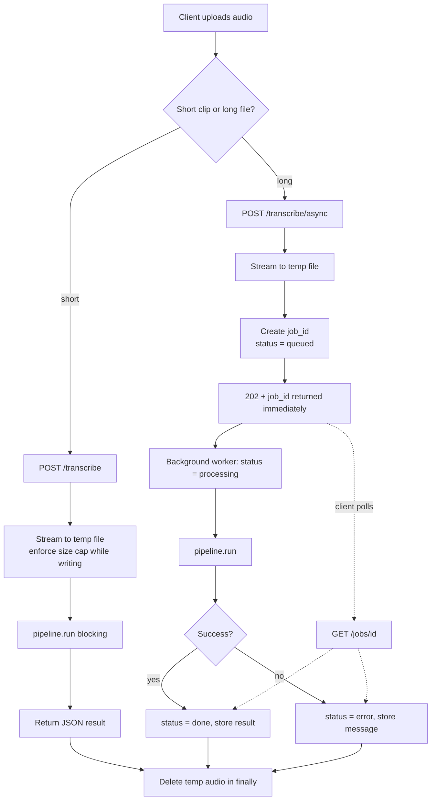
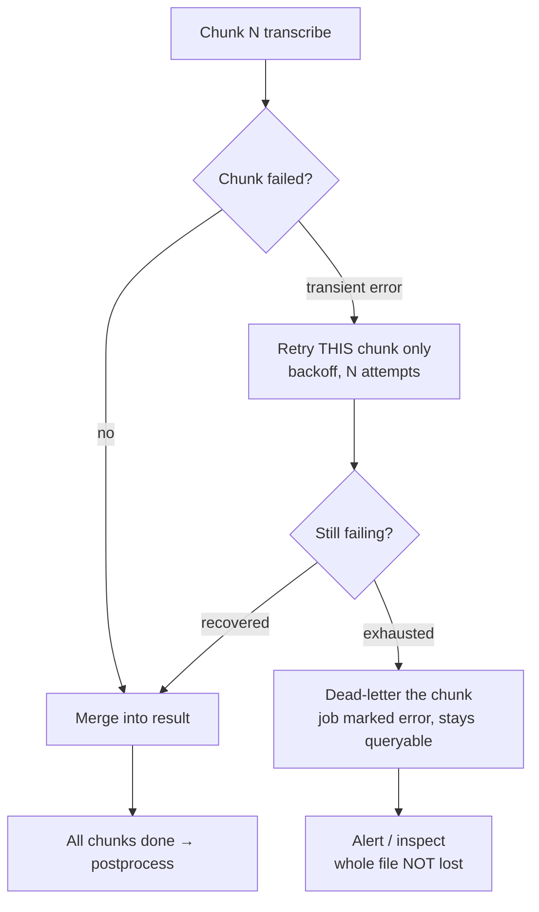
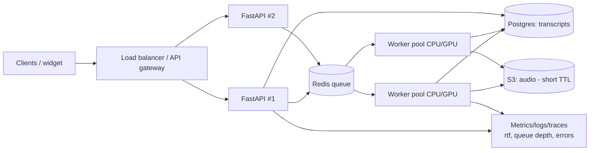

# Transcription Service — Design Notes, Diagrams & Video Cue Card

> One place for the assessment: the video cue card, the diagrams to show on screen,
> and the written system-design answers at a principal-engineer altitude
> (infra · support · operations · business).

---

## 1. Diagrams

### 1a. Architecture (what runs today)

```
            audio / video file  (wav, mp3, m4a, webm/opus, mp4/aac, …)
                                   │  multipart upload
                                   ▼
        ┌────────────────────────────────────────────────────────────┐
        │  FastAPI  (app/api.py)                                       │
        │    POST /transcribe        → sync    (short clips)           │
        │    POST /transcribe/async  → 202 + job_id (long audio)       │
        │    GET  /jobs/{id}         → progress / result               │
        │    GET  /health            → readiness + model/device        │
        └────────────────────────────────────────────────────────────┘
                                   │  pipeline.run()  (app/pipeline.py)
                                   ▼
   [1] ingest.py     validate by CONTENT (ffprobe) — reject corrupt / empty / no-audio / oversized
   [2] normalize.py  ffmpeg → 16 kHz mono 16-bit PCM WAV   (one canonical format; video→audio)
   [3] chunking.py   long audio → split at a silence near ~30s, with overlap  (ffmpeg silencedetect)
   [4] transcriber.py faster-whisper (int8, vad_filter, condition_on_previous_text=False)
                      + per-chunk timestamp OFFSET  ← the long-audio correctness point
   [5] postprocess.py merge chunks → drop overlap duplicates → re-id → export JSON / SRT / VTT
                                   │
                                   ▼
        JSON { job_id, language, duration_sec, model, rtf, segments[{id,start,end,text,avg_logprob}] }
```

### 1b. Request lifecycle — sync vs async (flowchart)



### 1c. Failure & recovery flow



### 1d. Production topology (what scale looks like)



---

## 2. Video cue card (one page — speak, don't read)

**Keep it human: explain it like you're talking to a teammate. Pause, breathe, redo a sentence if you fumble.**

| Show on screen | Say (roughly, your words) |
|---|---|
| **README top** | "Hey — this is my transcription service. Audio in, text out, with a timestamp on every segment. Built on faster-whisper and ffmpeg, and the audio never leaves my own servers." |
| **Architecture diagram** | "The hard parts aren't running a model — they're: any audio format, audio that's too long, getting timestamps right, and failing gracefully. I'll go file by file through that." |
| **`ingest.py` → `normalize.py`** | "I don't trust the file extension — I check the actual content with ffprobe and reject junk early. Then ffmpeg converts *everything* to one format, 16k mono. So the rest of the code only ever sees one shape." |
| **`chunking.py` → `transcriber.py`** *(point at the offset line)* | "Long files get split near 30 seconds — but at a silence, so I don't cut words in half. Each chunk gets transcribed, and *this* line adds the offset back, so the timestamps stay absolute to the original. That's the bug everyone hits with long audio." |
| **`postprocess.py`** | "Then I merge the chunks, drop the overlap duplicates, and export SRT or VTT." |
| **`api.py` → browser `/docs`** | "Two endpoints on purpose: sync for short clips, and an async one that hands back a job ID right away for long audio — because you can't hold an HTTP request open for twenty minutes. Here's the live docs." |
| **`finally` block → JSON `rtf`** | "On failure the job keeps its state instead of dying silent, and only the bad chunk retries. Every result carries `rtf` — that's my health metric. And the temp audio is deleted right after, nothing's kept." |
| **`tests/` → README Scaling** | "I test the real logic directly plus an accuracy check with Word Error Rate. To scale, the contract's already async — swap the in-memory store for Redis and a queue, add S3. The client doesn't change." |
| **Live chatbot — click mic** | "And it's actually live — it powers voice messages in my chatbot. Watch." *(speak a phrase, let it transcribe)* "That's it. Thanks!" |

**Before you record:** ☐ wake the mic once (15–30s cold start — don't record that) ☐ repo open one side, `/docs` + chatbot tabs ready ☐ aim 4–6 min.

---

## 3. System-design answers — principal-engineer altitude

> Framing: each answer gives the direct engineering answer first, then widens to the
> four lenses a principal is expected to carry — **infrastructure, support, operations,
> and business** — because the right design is the one that's cheap to run, easy to
> keep alive at 3 a.m., and honest about cost.

### Q1 — How would you handle concurrent uploads?

**Engineering.** Every request is independent: the upload is streamed to its own temp file with the size cap enforced *while* writing (never buffer a large file in memory), and work runs as its own job. Short clips go through the synchronous `/transcribe`; long audio returns `202 + job_id` and runs in the background, so the connection isn't held open. The real concurrency pattern is a **queue + stateless worker pool** (Redis + Celery/RQ): the API only accepts, validates, and enqueues; workers pull and process. Because long audio is already chunked, one file can also fan out across workers and merge.

- **Infra.** API and workers scale on different axes — the API is I/O-bound (cheap, scale on request rate), workers are CPU/GPU-bound (expensive, scale on queue depth). Keep them as separate deployables so I'm not paying for GPUs to parse HTTP. Autoscale workers on queue-depth / oldest-message-age, not CPU.
- **Operations.** The queue *is* the back-pressure mechanism: a bounded queue + max worker count means I degrade gracefully (latency rises, requests still accepted) instead of OOM-ing under a spike. Set a concurrency cap per worker (model memory is the constraint) and a global rate limit per API key so one tenant can't starve the rest.
- **Support.** A client that sends 200 files at once gets 200 job IDs instantly and a predictable queue position — a clear mental model when someone asks "why is mine slow?" The answer is observable (queue depth), not a mystery.
- **Business.** Queue-based decoupling is what lets me run **scale-to-zero** when idle and burst when busy — the single biggest cost lever for spiky, chatbot-style traffic. I pay for work done, not for a box kept warm.

### Q2 — How would you store audio and transcripts?

**Engineering.** Two different objects with two different lifecycles. **Audio** is a large, write-once, cold blob → object storage (S3) under a per-tenant key. **Transcripts** are small, structured, queryable records → Postgres (a row + a JSONB `segments` column), which lets me search by text or seek by timestamp. Today the service keeps *neither* — audio is written to a temp file and deleted in a `finally` block, success or failure; nothing goes to a third party.

- **Infra.** S3 with lifecycle rules (e.g. audio auto-expires in days, transcripts retained longer); Postgres for the index. Separating blob from metadata keeps the DB small and fast and makes the audio tier independently cheap (infrequent-access / Glacier if it must be kept at all).
- **Operations.** Retention is a *policy*, not an accident — an explicit TTL and auto-delete, encryption at rest and in transit, and signed, expiring URLs for any playback. Backups cover the transcript DB (the asset of record); audio backups are usually unnecessary if the transcript is the product.
- **Support.** When a user disputes a transcript, I can pull the exact record — model, `rtf`, timestamps, confidence (`avg_logprob`) — and explain *why* it said what it said. Keeping the per-segment confidence is a deliberate supportability choice.
- **Business / compliance.** This serves UAE/GCC users, so data residency and privacy (UAE PDPL, GDPR-style "right to delete") are real constraints, not footnotes. **Minimize what I store**: default to deleting audio fast and keeping only text, because every byte of retained voice is risk and cost with little upside. "We don't keep your audio" is also a sellable trust feature.

### Q3 — How do you retry or recover failed transcriptions?

**Engineering.** Isolate failure at two levels. (1) Long audio is chunked and each chunk transcribes independently, so a transient failure retries **just that chunk**, not the whole file, and the merge reassembles what succeeded. (2) The async job carries explicit state (`queued → processing → done/error`) and captures the error message instead of dying silently, so a failed job stays queryable and re-runnable. Ingest validates by content up front (ffprobe) and fails fast with a clear message, so genuinely broken files are rejected cheaply rather than retried forever.

- **Infra.** A real queue (Celery/RQ) gives **retries with exponential backoff** for free, and a **dead-letter queue** for the ones that exhaust retries — so nothing is silently lost. Moving the job store off in-memory onto Redis/DB means an in-flight job survives a worker crash or deploy.
- **Operations.** Distinguish *retryable* from *poison*: a network blip or OOM retries; a corrupt file does not (that's a 4xx, not a 5xx — retrying it just burns compute). Define this explicitly so the DLQ fills with genuinely interesting failures, which is what the on-call runbook points at.
- **Support.** Because state and the error string are preserved, support can answer "what happened to my file?" with a real status instead of a shrug — and re-queue it with one action.
- **Business.** Partial success matters commercially: on a 2-hour recording, recovering 118 good minutes and flagging 2 is a far better customer outcome (and a far smaller refund conversation) than failing the whole job because one chunk hiccuped.

### Q4 — How would you expose this as an API?

**Engineering.** FastAPI with a deliberately small surface: `POST /transcribe` (sync, short clips), `POST /transcribe/async` (`202 + job_id`, long audio), `GET /jobs/{id}` (poll), and `GET /health`. Input is a multipart upload with optional `language` and `format` (json/srt/vtt); output is a stable JSON contract (`job_id, language, duration_sec, model, rtf, segments[...]`). CORS is locked to the known caller origins, not `*`. Auto-generated OpenAPI docs at `/docs`.

- **Infra.** Containerized with ffmpeg installed and the Whisper model **baked into the image**, so a cold start loads from local disk (~10–20s) instead of re-downloading ~460 MB — the thing that makes scale-to-zero viable. Deployed behind a custom domain with TLS.
- **Operations.** Production-grade API means **auth** (per-tenant API keys), **rate limits / quotas** per key, **request IDs** propagated into logs and surfaced in errors, a **versioned contract** (`/v1/`) so I can evolve without breaking callers, and a `/health` + `/ready` split for sane load-balancer behavior. For long audio, add a **webhook/callback** option so callers don't have to poll.
- **Support.** The JSON contract is the support interface — stable field names, a documented error shape, and `rtf`/confidence in every response so integrators can self-diagnose before they open a ticket.
- **Business.** The sync/async split maps directly to two products: low-latency voice notes (the live chatbot use) and bulk/offline transcription (meetings, calls). Same service, and usage is meterable per key — duration transcribed is the natural billing unit, which makes "build vs. buy" a real number: self-hosting is fixed cost per warm box, a hosted API is pay-per-minute, and the crossover depends on volume. Low/spiky volume favours scale-to-zero self-host or an API; steady high volume favours a warm self-hosted pool. Say that trade-off out loud — it's the principal-level answer.

---

## 4. The one thing to land in the video

> "I didn't set out to train a model — I set out to make audio-to-text **correct, cheap to run, and safe to operate**. Every decision in here — normalize-everything, silence-aware chunking with timestamp offsets, async jobs, scale-to-zero, delete-the-audio — is one of those three."
